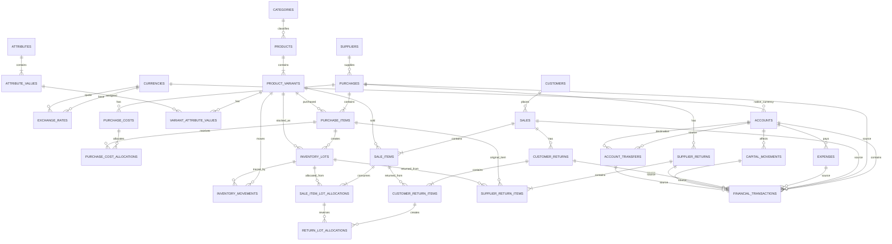

# Resale Manager — ERD

## 1. Core Diagram



---

## 2. Purchase Flow

```text
Supplier
   ↓
Purchase
   ↓
PurchaseItem
   ↓
InventoryLot
```

A purchase item may create multiple lots because receipts may be partial.

```text
Ordered: 10
Receipt 1: 6
Receipt 2: 4
```

---

## 3. Purchase Cost Flow

```text
Purchase
   ↓
PurchaseCost
   ↓
PurchaseCostAllocation
   ↑
PurchaseItem
```

Foreign-currency costs preserve original values and normalized purchase-currency values.

---

## 4. FIFO Sale Flow

```text
Sale
 ↓
SaleItem
 ↓
SaleItemLotAllocation
 ↓
InventoryLot
```

One sale item may consume multiple lots.

---

## 5. Customer Return Flow

```text
Sale
 ↓
CustomerReturn
 ↓
CustomerReturnItem
 ↓
ReturnLotAllocation
 ↓
SaleItemLotAllocation
 ↓
InventoryLot
```

A sellable return restores the historically consumed lot.

---

## 6. Supplier Return Flow

```text
Purchase
 ↓
SupplierReturn
 ↓
SupplierReturnItem
 ↓
InventoryLot
```

Supplier returns remove stock from the exact historical lot.

---

## 7. Financial Flow

```text
Business Operation
      ↓
FinancialTransaction
      ↓
Account
```

Examples:

```text
Sale             → +SALE
Purchase         → -PURCHASE
Expense          → -EXPENSE
Customer Return  → -CUSTOMER_REFUND
Supplier Return  → +SUPPLIER_REFUND
Capital In       → +CAPITAL_CONTRIBUTION
Capital Out      → -CAPITAL_WITHDRAWAL
```

---

## 8. Closed V1 Decisions

```text
Architecture       → Offline-first layered architecture
Database           → SQLite initially
Money              → Decimal
Quantities         → Integer units
Inventory costing  → FIFO
Inventory origin   → Inventory lots
Sale cost source   → FIFO allocations
Payments           → Full payment only
Credit             → Out of scope
Partial payments   → Out of scope
Partial receipts   → Supported
Customer returns   → Supported
Supplier returns   → Supported
Manual FX          → Supported
Automatic FX       → Supported
Internet           → Optional
Direct account FX  → Not implicit
```

---

## 9. Schema Readiness

Logical design is ready for physical implementation.

Implementation sequence:

```text
Logical model
    ↓
SQLAlchemy base/config
    ↓
Enums/value constraints
    ↓
Core catalog tables
    ↓
Products/variants
    ↓
Purchases/costs
    ↓
Inventory lots/movements
    ↓
Sales/FIFO allocations
    ↓
Returns
    ↓
Accounts/ledger
    ↓
Migrations
    ↓
Application use cases
```

Do not introduce new major V1 features during schema implementation unless required for correctness.
